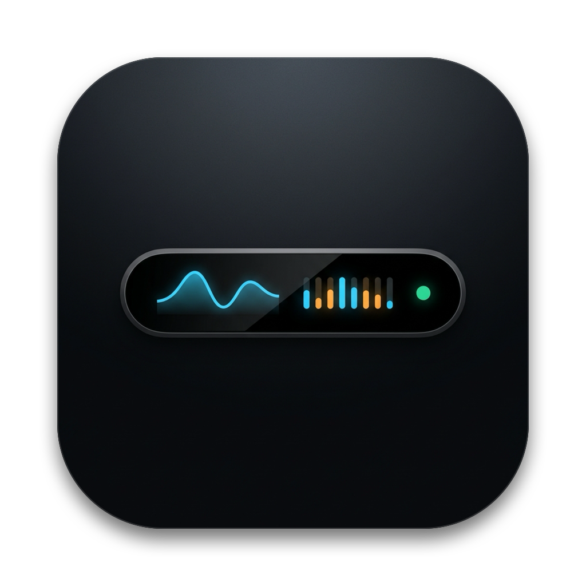
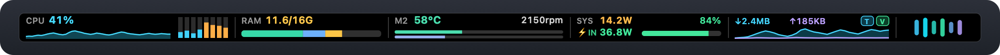
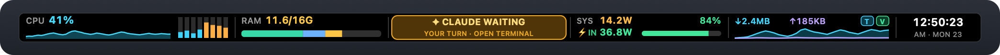

<p align="center">
  
</p>

<h1 align="center">TouchBarCockpit</h1>

<p align="center">
  A lightweight native Swift Touch Bar daemon for Apple Silicon MacBook Pros.<br/>
  Live hardware telemetry, eyes-free gestures, media scrubbing, a Dynamic Island–style audio waveform, and coding-agent alerts — in ~17 MB RAM with zero <code>sudo</code>.
</p>

<p align="center">
  
</p>

---

## Why?

Static buttons on glass without tactile feedback always lose to keyboard shortcuts. Instead of fighting your keyboard, **TouchBarCockpit** turns the full 1004×30pt Retina OLED strip into the three things a mechanical keyboard can't do:

1. **A zero-screen-estate hardware HUD** — CPU sparkline + per-core E/P load bars, unified memory & swap pressure, M2/M1 SoC die temperature & SMC fan RPM, live system draw vs. charger wattage, network throughput + VPN/Tailscale/Proxy badges, and a 12-hour clock that transforms into a live audio FFT waveform when media plays.
2. **An eyes-free analog gesture surface** — slide anywhere with 2 fingers for volume or 3 fingers for brightness, then drop to 1 finger mid-drag for fine precision. No icons taking up space, no looking down.
3. **An ambient peripheral alert strip** — gently glows warm amber when your coding agent (Antigravity, Claude Code, Codex, or any long-running build) finishes its turn and waits for you, then pins a reminder in the thermal slot until you switch back to your terminal.

---

## Views & Features

### Hardware Telemetry + Dynamic Island Audio Waveform


* **CPU** — 48-second rolling sparkline + per-core vertical bars (E-cores in cyan, P-cores in amber). Tap for top 3 CPU processes.
* **RAM** — Segmented Activity Monitor–style bar (`Active` / `Wired` / `Compressed`) + live `SW` swap alert badge. Tap for top 3 memory consumers.
* **SoC Thermal & Fan** — Live die temperature (`IOHIDEventSystemClient`) and SMC fan RPM (`AppleSMC`). Tap for peak die temp and fan load %.
* **Dual Power (1 Hz SMC)** — Reads real-time `PSTR` (system draw) and `PDTR` (charger pull) directly from `AppleSMC` every second — not the 30s-cached battery telemetry. Tap for PD adapter & net battery flow.
* **Network & Privacy** — Live `↓ / ↑` throughput in `B` / `KB` / `MB` with dual sparklines, plus glowing `T` (Tailscale), `V` (VPN), and `P` (system proxy) indicators.
* **Clock ↔ Live Audio Waveform** — Shows 12-hour time when quiet. When audio plays, automatically switches to a 6-band real-time `vDSP` FFT waveform captured via macOS's native CoreAudio Process Tap (no virtual audio drivers, tears down completely at `0%` CPU when silent).

### Media Overlay & Scrubber


* **Tap the waveform / clock** to open the pinned Media Overlay without pausing playback (stays open until you tap `✕`, auto-updating when tracks advance).
* **Long-press anywhere (~0.4s)** to immediately pause playback and bring up the Media Overlay (auto-dismisses after 10s of inactivity).
* Displays rounded **album cover art** (Apple Music & Spotify), **smooth marquee scrolling** for long track/artist names, the **playing app's icon** (Apple Music, Spotify, Zen, Chrome, IINA, VLC), and an **Apple-style progress scrubber** (or `-10s` / jog scrubber / `+10s` for browser video tabs like YouTube).

### Eyes-Free Volume & Brightness Gestures


* **2-finger slide anywhere** → Volume (1/64th fine native HID steps + macOS main-display HUD popup). **2-finger tap** → Mute toggle.
* **3-finger slide anywhere** → Built-in display brightness (1/64th fine native HID steps + macOS main-display HUD popup).
* **Zero-jump handoff to 1 finger** — lift extra fingers (`3 → 1` or `2 → 1`) mid-drag with zero jump to switch to finer `0.65×` sensitivity. The slider lingers for 3 seconds after lifting so you can drop 1 finger back down for final adjustments.

### Coding Agent Turn-Complete Alerts



* When an agent finishes its turn, the entire Touch Bar gently breathes warm amber for 3.2 seconds, then replaces the thermal panel with a persistent **`✦ <AGENT> WAITING`** badge.
* Switching to **Ghostty, kitty, iTerm2, Warp, or Terminal** automatically clears the badge back to live temps (event-driven via `NSWorkspace`, zero polling). Tapping the badge jumps straight to your terminal and clears it.

---

## Controls Cheat Sheet

| Gesture / Action | Behavior |
| :--- | :--- |
| **2-finger slide anywhere** | Adjust volume (drop to 1 finger for fine control) |
| **2-finger tap anywhere** | Toggle mute |
| **3-finger slide anywhere** | Adjust display brightness (drop to 1 finger for fine control) |
| **Tap waveform / clock** | Open pinned Media Overlay without pausing |
| **Long-press anywhere (~0.4s)** | Pause media & open auto-dismissing Media Overlay |
| **Single-tap `Fn`** | Pause cockpit & restore macOS's native Touch Bar (tap `Fn` again to resume) |
| **Single-tap any cockpit panel** | Show inline breakdown (top CPU/RAM procs, peak temp/fan, PD power, VPN/proxy) |
| **Menu bar waveform icon** | Live summary, Keep Awake (`IOPMAssertion`), Pause/Resume, Re-attach, Quit |

---

## Measured Resource Footprint

Measured via `top` on a 13" M2 MacBook Pro (macOS Tahoe):

| State | CPU (of 1 E-core) | Idle Wakeups | Private RAM |
| :--- | :---: | :---: | :---: |
| **Idle / Coding (Clock mode)** | **0.6% – 0.9%** | **0 / sec** | **~17 MB** |
| **Audio Playing (15 FPS FFT waveform)** | **~2.9%** | **~2 / sec** | **~18 MB** |
| **Paused (`Fn`) / Display Asleep** | **~0.0%** | **0 / sec** | **~17 MB** |

Because the Touch Bar is OLED and ~85% of the cockpit is pure `#000000` black, the display strip itself draws less power than Apple's solid-gray Control Strip.

---

## Quick Start

### Requirements
* Apple Silicon MacBook Pro with Touch Bar (M1 / M2 13")
* macOS 14.2+ (uses CoreAudio Process Taps)
* Xcode Command Line Tools (`xcode-select --install`)

### Build & Run
```bash
git clone https://github.com/mebinthattil/touchbar-cockpit.git
cd touchbar-cockpit
./Scripts/build-app.sh
open build/TouchBarCockpit.app
```

> `build-app.sh` automatically signs with your local `Apple Development` certificate if present so macOS permissions persist across rebuilds (falling back to ad-hoc signing otherwise).

### Auto-Start at Login (Optional)
```bash
./Scripts/install-launchagent.sh

# To uninstall:
./Scripts/install-launchagent.sh --uninstall
```

### Recommended One-Time Setup
1. **Accessibility (for native macOS HUD popups & zero-polling `Fn` tap):** Click the menu bar waveform icon → **Enable macOS HUD Popup (Grant Accessibility)...** and enable `TouchBarCockpit`.
2. **Disable `Fn` Emoji Picker (optional):** If tapping `Fn` opens macOS's Emoji picker, set **System Settings → Keyboard → Press 🌐 key to → Do Nothing** (or run `defaults write com.apple.HIToolbox AppleFnUsageType -int 0`).
3. **System Audio Recording Only & Automation:** macOS will prompt once when you play audio (for the live FFT waveform) and once when opening Media Overlay with Apple Music or Spotify (for album art & scrubbing).

---

## Coding Agent Hooks

Trigger the amber turn-complete alert from any tool or script via the built-in `--flash` flag (~4ms, zero-polling `DistributedNotificationCenter`):

```bash
build/TouchBarCockpit.app/Contents/MacOS/TouchBarCockpit --flash "Build"
```

* **Antigravity (`~/.gemini/config/hooks.json`):** Add a `Stop` hook calling `Scripts/notify-agent-ready.sh agy`.
* **Claude Code (`~/.claude/settings.json`):** Add `Stop` and `Notification` hooks calling `Scripts/notify-agent-ready.sh Claude`.
* **Codex (`~/.codex/config.toml`):** Point `notify` to `Scripts/codex-notify-wrapper.sh` (preserves Codex Computer Use's `turn-ended` hook if installed).

---

## Project Structure

```text
Sources/
├── CPrivateAPIs/                   # DFRFoundation, DisplayServices, AppleSMC (PSTR/PDTR/F0Ac), IOHID thermals, ARM64 atomics
└── TouchBarCockpit/
    ├── main.swift                  # Bootstrap, single-instance guard, --flash & --render-screenshots CLI
    ├── AppDelegate.swift           # Coalesced 1 Hz loop, event-driven Fn toggle, sleep/wake & terminal focus observers
    ├── Telemetry/                  # CPUSampler, MemorySampler, ThermalSampler, PowerSampler, NetworkSampler, AudioSpectrumTap
    ├── Controls/                   # AudioController, BrightnessController, MediaController, KeepAwakeManager
    └── UI/                         # TouchBarController, CockpitView (CoreGraphics OLED renderer + multi-touch gestures)
Scripts/
├── build-app.sh                    # Release build, .app bundle packaging, Apple Development / ad-hoc signing
├── install-launchagent.sh          # Login LaunchAgent installer / uninstaller
├── notify-agent-ready.sh           # Hook script for Antigravity / Claude Code
└── codex-notify-wrapper.sh         # Codex notify wrapper
```

---

## License

[MIT](LICENSE)
